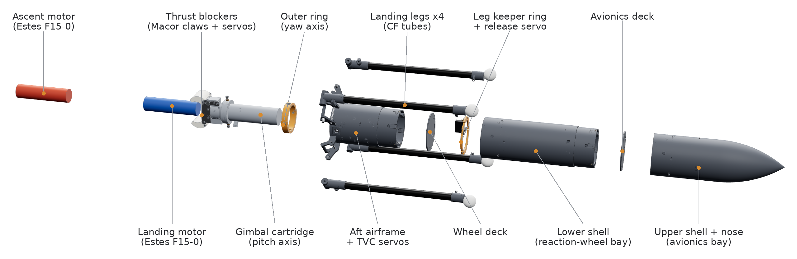
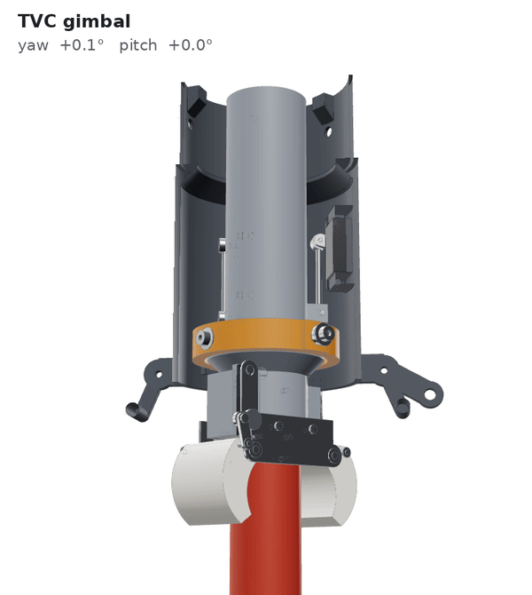
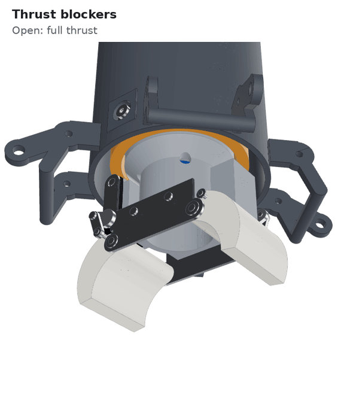
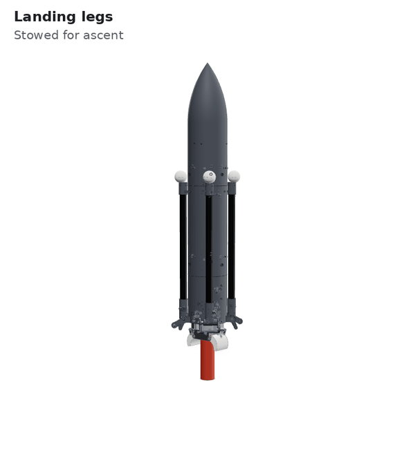

# TVC Rocket Hardware

CAD and hardware for a thrust-vector-controlled model rocket that flies up on one Estes F15 and lands itself on a second one. It steers with a 2-axis motor gimbal, throttles the landing motor with ceramic thrust blockers, and touches down on four carbon-fibre legs.

The flight software and 6-DOF simulator live in **[TVC_Rocket_Firmware](https://github.com/JamesGossy/TVC_Rocket_Firmware)**.



| | |
|---|---|
| Body | 79.5 mm OD, 639 mm long (nose tip to ascent motor), mostly PAHT-CF printed on a Bambu H2D |
| Motors | 2x Estes F15-0 stacked in one gimballed cartridge: ascent below, landing above. The landing motor kicks the spent case out. |
| Mass | ~1.0 kg at liftoff with placeholder electronics (0.94 kg with the reaction-wheel bay empty) |
| Steering | 2-axis gimbal, 8 deg command circle, 8.75 deg hard stop, 2x KST X08H Plus servos |
| Throttle | 2 Macor thrust-blocker claws in the landing motor's exhaust, down to ~60 % thrust |
| Legs | 4x CF 14x12 tubes, spring-deployed to 119 deg and locked by spring plungers, 0.60 m footprint, EPS foam feet |
| Parts | 153 pieces, 16 printed parts, ~411 g of filament, ~31 h of printing |

## TVC gimbal



The motor cartridge (grey) pitches inside an outer ring (orange), and the ring yaws inside the aft airframe:

- **Yaw:** the ring runs on MF84ZZ bearings.
- **Pitch:** the cartridge runs on M3 shoulder screws in bonded bronze bushes.

Each axis is driven by a KST X08H Plus servo through a 33.5 mm pushrod, with a U-joint at the horn and a ball link at the cartridge.

The firmware clips the request to an 8 deg circle so the cartridge never hits the 8.75 deg stop. It maps gimbal angles to servo angles with a table generated from this CAD (`firmware_snippets/tvc_command_map.h`), which includes the small cross-coupling between the axes.

## Thrust blockers



Black-powder motors can't be throttled, so two crescent claws of machinable Macor ceramic swing into the landing motor's exhaust instead. Fully closed, they choke the thrust to about 60 %, which is enough range to fly a braking curve down to the ground.

- Each claw has its own KST X08H Plus servo and a short 304 stainless link.
- When closed, the link sits at dead centre, so the servo isn't holding against the exhaust.
- The claws stay open during the ascent and only close once the landing motor has kicked the spent ascent case out.

## Landing legs



Each leg is just a 14x12 mm carbon-fibre tube bonded into a printed knuckle, with a tip cap and a 25 mm EPS foam ball as the foot. That's 9 pieces per leg, including the hinge pin, E-clips, spring and plunger.

1. **Ascent:** the legs ride folded against the body. A printed peg on the keeper ring passes through a tab on each tip cap.
2. **Release:** one servo turns the keeper ring 9 deg, and all four pegs slide out together.
3. **Deploy:** a torsion spring on each hinge swings the leg out to 119 deg, where it hits a stop bar printed into the aft airframe.
4. **Lock:** an M6 spring plunger rides up a ramp on the knuckle and drops into a hole, so landing loads can't fold the leg back.

The footprint is 0.60 m and the feet sit 30 mm below the end of the ascent motor. The foam balls crush progressively without bouncing; treat them as consumables.

## Body

The forward body is two printed shells joined by screwed spigots: 3x M2x4 screws into heat-set inserts with crush ribs.

- **Lower shell:** a 155 mm reaction-wheel bay (empty for now) plus the leg keeper.
- **Upper shell:** the avionics bay and an integral 1.5:1 ogive nose.
- **Decks:** two identical printed decks, the gas barrier above the motors and the avionics deck.

The 0.64 m body is split this way because the H2D prints at most 325 mm tall.

## Mass properties

From the Fusion model with real materials on every body, datasheet masses on purchased parts, and 145 g of editable placeholders: 60 g roll wheel, 40 g avionics, 35 g battery, 10 g wiring. CG is measured above the aft end of the ascent motor.

| State | Mass | CG | Pitch inertia (about CG) |
|---|---|---|---|
| Liftoff, legs stowed | 1000 g | 233 mm | 0.0209 kg m² |
| Landing motor loaded, legs stowed | 906 g | 252 mm | 0.0176 kg m² |
| Landing motor loaded, legs deployed | 906 g | 230 mm | 0.0216 kg m² |
| Landing burnout, legs deployed | 845 g | 233 mm | 0.0214 kg m² |

Plateau thrust-to-weight on the landing burn is about 1.46. Full numbers, including gimbal inertias and suggested sim settings, are in `CAD/Designs/TVC_Rocket_v3_mass_properties.json`.

## What's in here

```
CAD/Designs/
  TVC_Rocket_v3_BOM.md / .csv              every part: material, process, print orientation, mass
  TVC_Rocket_v3_material_spec.md           why each part is made of what it's made of
  TVC_Rocket_v3_mass_properties.json/.csv  mass, CG and inertia for each flight state
  TVC_Rocket_Gimbal_v3_BOM.md              gimbal and blocker hardware notes
  research_*.md                            notes from open-source rockets and lander legs
firmware_snippets/
  tvc_command_map.h                        gimbal angle -> servo angle table from the CAD kinematics
media/                                     the images on this page (rendered from the Fusion model)
```

The Fusion design is **TVC_Rocket_Gimbal_v3**.

## Still to do

- Weigh the purchased parts marked "verify" (servos, spring plungers, torsion springs) and bench-check the KST X08H Plus speed.
- Leg tests: deployment against descent airflow, plunger hole wear after drop tests, foam crush force.
- Stop the ascent motor's forward burn-through from lighting the landing motor early (fix not designed yet).
